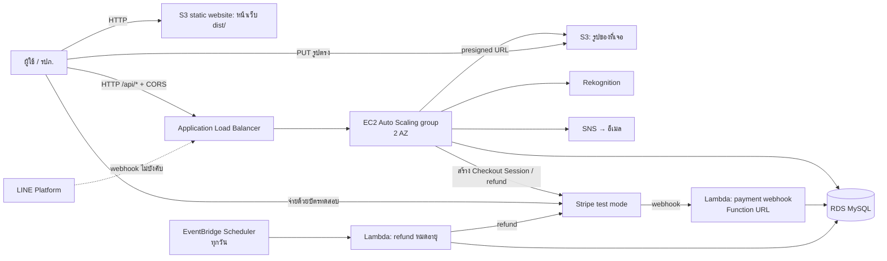
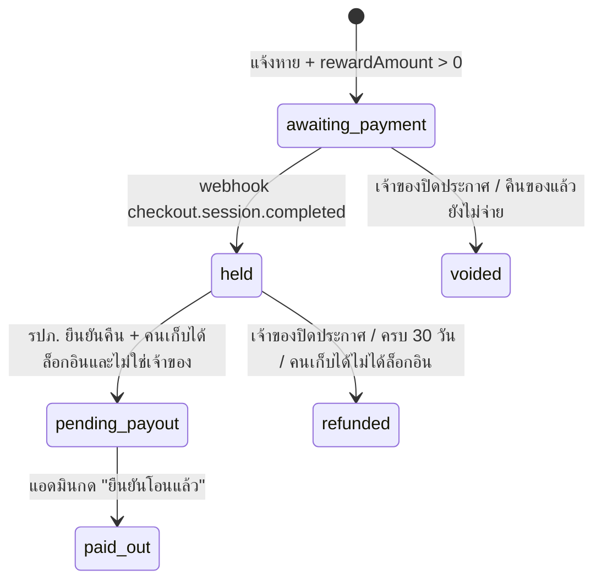

# BU Lost & Found — API Contract (v6)

> **มีอะไรใหม่ใน v6 — ไม่ใช้ CloudFront + หลายรูป + ปิดเลขบัตร (ฝั่ง backend ต้องทำ):**
> 1. **ตัด CloudFront ออก** (Learner Lab ไม่ให้สร้าง) → หน้าเว็บอยู่บน S3 static website (HTTP) เรียก ALB ตรง ๆ ทาง HTTP → **API ต้องตอบ CORS** ให้ origin ของ S3 website — ข้อ 0 และข้อ 4
> 2. `POST /api/items` และ `POST /api/lost-reports` รับ `imageKeys: string[]` (ไม่เกิน 4 รูป, รูปแรกคือรูปปก) แทน `imageKey` · `FoundItem` เพิ่ม `imageUrls`, `cardNumberMasked` · `MyLostReport` / `PublicLostReport` เพิ่ม `imageUrls`
> 3. **ปิดเลขบัตรอัตโนมัติ** ในรูปของที่เจอด้วย Rekognition `DetectText` ก่อนเผยแพร่ — ข้อ 3
> 4. บอร์ดสาธารณะ `GET /api/lost-reports` **ส่ง `description` แล้ว** (หน้าฟอร์มเตือนเจ้าของไม่ให้ใส่จุดสังเกตลับ) — ยังห้ามส่ง `student_id`, `contact_*`, `owner_email`
> 5. `title` ยาวได้ไม่เกิน 60 ตัวอักษร, `description` ไม่เกิน 500 → เกิน = `400 VALIDATION`
> 6. หน้าแจ้งของหายที่ตั้งรางวัลจะเรียก `POST /api/lost-reports/{id}/reward/checkout` ต่อทันทีหลังสร้าง แล้วพาไปจ่ายเงินเลย (ไม่ต้องแก้ backend)
> 7. schema: ตารางใหม่ `item_images`, `lost_report_images` — SQL อยู่ท้ายข้อ 7

> **v5 — รางวัลแบบพักเงิน (escrow) · โหมดทดสอบเท่านั้น (ฝั่ง backend ต้องทำ):**
> 1. `POST /api/lost-reports` รับ `rewardAmount` (บาท, `0` = ไม่ตั้ง) · response และ `GET /api/lost-reports/mine` มี `reward`
> 2. เพิ่ม `POST /api/lost-reports/{id}/reward/checkout` 🔒 → สร้าง Stripe Checkout Session (test mode)
> 3. เพิ่ม Lambda รับ webhook จาก Stripe (`checkout.session.completed`) และ Lambda ที่ EventBridge Scheduler เรียกทุกวันเพื่อคืนเงินรางวัลที่ครบ 30 วัน — ข้อ 2b
> 4. `POST /api/items` บันทึก `finder_email` จาก JWT (token ไม่บังคับ) · `POST /api/items/{id}/claims` รับ `lostReportId` · `POST /api/admin/claims/{id}/return` ปล่อยรางวัล · `POST /api/lost-reports/{id}/close` คืนเงิน
> 5. เพิ่ม `GET /api/admin/payouts?status=pending_payout` 🔒 และ `POST /api/admin/payouts/{rewardId}/paid` 🔒 (รายการ "รอโอน" ที่แอดมินกดยืนยัน ไม่มีการโอนจริง)
> 6. บอร์ดสาธารณะเพิ่ม `hasReward` (true/false เท่านั้น **ห้ามส่งจำนวนเงิน**) · `GET /api/lost-reports/mine` เพิ่ม `earnedRewards`
> 7. schema: ตารางใหม่ `rewards`, `found_items.finder_email`, `claims.lost_report_id` — SQL อยู่ท้ายข้อ 7

> **v4:**
> 1. `POST /api/lost-reports` **เปลี่ยนเป็น 🔒 ต้องล็อกอิน** — เจ้าของรายงานอ่านจาก JWT ห้ามใช้ `contact.email` ในฟอร์ม
> 2. เพิ่ม `GET /api/lost-reports/mine` 🔒, `POST /api/lost-reports/{id}/close` 🔒 และบอร์ดสาธารณะ `GET /api/lost-reports`
> 3. `POST /api/items/{id}/claims` ถ้ามี token ให้บันทึกเจ้าของ claim ด้วย (ยังไม่บังคับล็อกอิน)
> 4. schema: `lost_reports` เพิ่ม `owner_email` + index, เปลี่ยน `status` เป็น `searching/found/cancelled`, เพิ่ม `closed_at` · `claims` เพิ่ม `owner_email` + index — SQL สำหรับแก้ตารางเดิมอยู่ท้ายข้อ 7

ข้อตกลงระหว่างหน้าเว็บ (`web/`) กับ backend
Type ฝั่งหน้าเว็บอยู่ที่ [`web/src/api/contract.ts`](../web/src/api/contract.ts) — **ถ้าแก้เอกสารนี้ต้องแก้ไฟล์นั้นด้วย**

> ⚠️ **กฎข้อเดียวที่ห้ามพลาด:** `verificationAnswer` (คำตอบที่ถูกของคำถามยืนยัน) เก็บไว้ในฐานข้อมูลเท่านั้น
> **ห้ามส่งกลับไปในทุก response** ไม่ว่า endpoint ไหน — backend เป็นคนตรวจคำตอบที่ `POST /api/items/{id}/claims` เอง

## 0. สถาปัตยกรรม (v6: ไม่มี CloudFront)



| ส่วน | ใช้อะไร | หมายเหตุ |
|---|---|---|
| หน้าเว็บ | S3 static website hosting | `npm run build:aws` แล้วอัปโหลด `web/dist/` — URL แบบ `http://<web-bucket>.s3-website-us-east-1.amazonaws.com` |
| API | ALB → EC2 Auto Scaling (min 1, desired 2, max 3, กระจาย 2 AZ) | target group health check `GET /api/health` |
| ฐานข้อมูล | RDS MySQL 8 (`db.t3.micro`) | อยู่ private subnet, security group เปิด 3306 ให้ SG ของ EC2 เท่านั้น — schema ข้อ 7 |
| รูป | S3 (bucket แยกจากหน้าเว็บ) + presigned URL | เก็บต้นฉบับใน `private/`, รูปที่ปิดเลขบัตรแล้วใน `public/` — ข้อ 3 |
| AI | Rekognition `DetectLabels`, `DetectText` | ข้อ 3 |
| อีเมล | SNS | ข้อ 2 |
| รางวัล | Stripe **test mode** + Lambda (webhook, refund) + EventBridge Scheduler | ข้อ 2b · Lambda ต้องอยู่ใน VPC/subnet เดียวกับ RDS และใช้ role `LabRole` |

**ทำไมใช้ HTTP ทั้งหมด:** Learner Lab ไม่ให้สร้าง CloudFront และ ALB ไม่มี HTTPS (ACM ต้องมีโดเมน) · S3 website endpoint เป็น HTTP อยู่แล้ว หน้าเว็บ HTTP จึงเรียก `http://…elb.amazonaws.com/api` ได้โดยไม่ติด mixed content — ใส่ URL นี้ใน `VITE_API_BASE` ของ `web/.env.aws`
- เพราะหน้าเว็บกับ API อยู่คนละ origin **API ต้องตอบ CORS** (ข้อ 4) และ security group ของ ALB ต้องเปิด 80 ให้ `0.0.0.0/0`
- เปิด S3 website: ปิด Block Public Access ของ bucket หน้าเว็บ + bucket policy `s3:GetObject` ให้ `*` + Static website hosting (index document = `index.html`)
- **ทางเลือก (ไม่ต้องตั้ง CORS):** ให้ EC2 เสิร์ฟไฟล์ `dist/` เองด้วย (เช่น `express.static`) แล้วเปิดเว็บที่ `http://<ALB DNS>/` — หน้าเว็บกับ API อยู่ origin เดียวกัน ใช้ `VITE_API_BASE=/api` ได้เลย แต่หน้าเว็บจะไม่ได้อยู่บน S3
- HTTP ไม่เข้ารหัส: ใช้ได้สำหรับ demo ในวิชาเท่านั้น อย่าใช้รหัสผ่านจริง

**Learner Lab (AWS Academy):**
- Region **`us-east-1`** เท่านั้น (หรือ `us-west-2`)
- สร้าง IAM role เองไม่ได้ → launch template ของ EC2 ใช้ instance profile **`LabInstanceProfile`** แล้ว AWS SDK บนเครื่องจะได้สิทธิ์ S3 / SNS / Rekognition เอง ไม่ต้องใส่ access key ในโค้ด
- ปิด lab แล้ว resource อาจถูกหยุด → ก่อน demo ให้ start lab แล้วเช็กว่า EC2, RDS และ target health เป็นปกติ

**Service ที่นับคะแนนได้ (ไม่นับสีม่วง):** EC2, EC2 Auto Scaling, Elastic Load Balancing, RDS, S3, EBS (ดิสก์ของ EC2), Rekognition, SNS · v5 เพิ่ม Lambda และ EventBridge (ตรวจกับเกณฑ์อีกครั้งว่านับคะแนนหรือไม่)

## 1. สรุป endpoint

| Method | Path | ใช้ที่หน้า | Auth |
|---|---|---|---|
| GET | `/api/health` | ALB health check | – |
| GET | `/api/locations` | ทุกฟอร์ม (dropdown จุดที่เจอ / จุดรับฝาก) | – |
| GET | `/api/stats` | หน้าแรก (3 กล่องตัวเลข), หน้า รปภ. | – |
| GET | `/api/items?q=&category=&location=&status=` | หน้าแรก | – |
| GET | `/api/items/{id}` | หน้ารายละเอียด | – |
| POST | `/api/uploads` | แจ้งเจอของ (ขอ presigned URL รูป) | – |
| POST | `/api/items` | แจ้งเจอของ | – |
| POST | `/api/lost-reports` | แจ้งของหาย | 🔒 ทุก role (**ใหม่ใน v4**) |
| GET | `/api/lost-reports/mine` | หน้า "ของที่ฉันแจ้งหาย" | 🔒 ทุก role |
| POST | `/api/lost-reports/{id}/close` | หน้า "ของที่ฉันแจ้งหาย" ปุ่ม "ได้ของคืนแล้ว / ยกเลิกประกาศ" | 🔒 เจ้าของรายงาน |
| GET | `/api/lost-reports` | หน้า "ประกาศตามหา" (บอร์ดสาธารณะ) | – |
| POST | `/api/items/{id}/claims` | ปุ่ม "นี่ของฉัน" | – (ถ้ามี token จะผูก claim กับบัญชี) |
| GET | `/api/admin/claims?status=verified` | หน้า รปภ. แท็บ "รอส่งคืน" | 🔒 guard |
| POST | `/api/admin/claims/{claimId}/return` | หน้า รปภ. ปุ่ม "ยืนยันคืนแล้ว" | 🔒 guard |
| GET | `/api/admin/items/stale?days=30` | หน้า รปภ. แท็บ "ของค้างนาน" | 🔒 guard |
| POST | `/api/lost-reports/{id}/reward/checkout` | ปุ่ม "ชำระรางวัล" | 🔒 เจ้าของรายงาน |
| GET | `/api/admin/payouts?status=pending_payout` | หน้า รปภ. แท็บ "รอโอนรางวัล" | 🔒 guard |
| POST | `/api/admin/payouts/{rewardId}/paid` | หน้า รปภ. ปุ่ม "ยืนยันโอนแล้ว" | 🔒 guard |
| POST | Lambda Function URL (ไม่ผ่าน `/api`) | Stripe เรียก webhook | ลายเซ็น `Stripe-Signature` |
| POST | `/api/auth/login` | หน้าเข้าสู่ระบบ | – |
| POST | `/api/auth/register` | หน้าสมัครสมาชิก | – |
| GET | `/api/me` | หน้าบัญชีของฉัน | 🔒 ทุก role |
| PUT | `/api/me` | หน้าบัญชีของฉัน ปุ่ม "บันทึกข้อมูล" | 🔒 ทุก role |
| POST | `/api/me/password` | หน้าบัญชีของฉัน ปุ่ม "เปลี่ยนรหัสผ่าน" | 🔒 ทุก role |
| POST | `/api/line/webhook` | LINE Platform เรียก (ไม่ใช่หน้าเว็บ) — ไม่บังคับ ดูข้อ 2 | ลายเซ็น LINE |

## 2. การแจ้งเตือนทางอีเมล: Amazon SNS (ตกลงแล้ว)

**ทำไมไม่ใช้ SES:** SES ใน Learner Lab อยู่โหมด sandbox ส่งได้เฉพาะอีเมลที่ verify ไว้ก่อน ใช้กับผู้ใช้จริงไม่ได้ ส่วน SNS ส่งหาอีเมลใดก็ได้หลังผู้รับกดยืนยันครั้งแรก

**ออกแบบ: 1 topic ต่อ 1 อีเมล** ผู้ใช้กดยืนยันแค่ครั้งแรกครั้งเดียว แจ้งของหายกี่ครั้งก็ใช้ topic เดิม

1. **ตอน `POST /api/lost-reports`**
   ```js
   // topic name ต้องเป็น A-Z a-z 0-9 - _ ≤ 256 ตัว จึงใช้ hash ของอีเมล
   const name = "lostfound-" + sha256(email.toLowerCase()).slice(0, 32);
   const { TopicArn } = await sns.createTopic({ Name: name, Attributes: { DisplayName: "BU Lost & Found" } }); // ชื่อซ้ำ = ได้ topic เดิม
   await sns.subscribe({ TopicArn, Protocol: "email", Endpoint: email });                                   // อีเมลเดิมที่ยืนยันแล้ว = ไม่ส่งซ้ำ
   // เก็บ TopicArn ลง lost_reports.sns_topic_arn
   ```
   `DisplayName` ทำให้ชื่อผู้ส่งเป็น "BU Lost & Found" — หน้าเว็บบอกผู้ใช้ให้มองหาชื่อนี้และกด **Confirm subscription** (มีกล่องเตือนในหน้ายืนยันแล้ว)
2. **ตอนมีของที่ตรงกัน** (หลัง `POST /api/items` หรือจาก Rekognition ข้อ 3)
   ```js
   await sns.publish({
     TopicArn: report.sns_topic_arn,
     Subject: "มีคนแจ้งเจอของที่อาจเป็นของคุณ",   // ≤ 100 ตัวอักษร
     Message: `${item.title}\nฝากไว้ที่: ${dropOff.name} (${dropOff.hours})\nดูรายละเอียด: ${WEB_URL}/#/items/${item.id}`,   // WEB_URL = http://<web-bucket>.s3-website-us-east-1.amazonaws.com (env ของ EC2)
   });
   ```
3. **ปิดเรื่อง** (คืนของแล้ว หรือเจ้าของกดปิดเองที่ `POST /api/lost-reports/{id}/close`) → `lost_reports.status` เป็น `'found'` หรือ `'cancelled'` แล้วไม่ต้อง publish อีก ไม่ต้องลบ topic · publish เฉพาะรายงานที่ `status = 'searching'`

**LINE (ไม่บังคับ):** ส่ง push ได้เฉพาะ `userId` ของคนที่แอด LINE OA แล้ว — ผู้ใช้แอดเพื่อนจากการ์ดในหน้ายืนยัน แล้วพิมพ์รหัสแจ้ง เช่น `lst-8f2a` ในแชท → LINE เรียก `POST /api/line/webhook` → ตรวจ `x-line-signature` → บันทึก `event.source.userId` ลง `lost_reports.line_user_id` → ตอนมีของตรงกันส่ง push เพิ่มจากอีเมล · `contact.lineId`, `contact.phone` ในฟอร์มมีไว้ให้ รปภ. ติดต่อกลับเท่านั้น

## 2b. รางวัลแบบพักเงิน (escrow) — โหมดทดสอบเท่านั้น

> ⚠️ **ห้ามรับเงินจริง** การรับชำระออนไลน์ต้องจดทะเบียนธุรกิจ และการถือเงินคนอื่นไว้ก่อนโอนต่อมีกฎของแบงก์ชาติกำกับ → ใช้ Stripe **test mode** (`sk_test_…`) และบัตรทดสอบเท่านั้น การโอนให้คนเก็บได้เป็นแค่รายการ "รอโอน" ที่แอดมินกดยืนยัน ไม่มีการโอนจริง
> อ้างอิงตอนนำเสนอ: ป.พ.พ. มาตรา 1323–1324 ให้สิทธิ์คนเก็บของตกได้เรียกรางวัลจากเจ้าของอยู่แล้ว แอปแค่ทำให้ง่ายและโปร่งใสขึ้น (ถ้าจะอ้างเปอร์เซ็นต์ในสไลด์ ให้ตรวจตัวบทอีกครั้ง)



| กติกา | ค่า |
|---|---|
| จำนวนรางวัล | จำนวนเต็ม `20`–`500` บาท (`REWARD_MIN_BAHT`, `REWARD_MAX_BAHT`) หรือ `0` = ไม่ตั้ง |
| ค่าธรรมเนียม | `fee = round(amount × 0.10)` · คนเก็บได้ได้ `amount − fee` |
| ระยะพักเงิน | 30 วันนับจาก `paid_at` (`expires_at`) แล้วคืนเงินอัตโนมัติ — **ประกาศยังเปิดอยู่** แค่ไม่มีรางวัลแล้ว |

**กันคนขโมยของแล้วมาอ้างว่าเก็บได้:**
- บอร์ดสาธารณะส่งแค่ `hasReward` (true เมื่อ `status = 'held'`) **ห้ามส่งจำนวนเงิน** ทุก endpoint สาธารณะ
- จำกัดสูงสุด 500 บาท
- ปล่อยเงิน**หลัง รปภ. ยืนยันคืนเท่านั้น** (`POST /api/admin/claims/{id}/return`) ไม่มี endpoint อื่นที่เปลี่ยนเป็น `pending_payout`
- คนรับรางวัลต้องเป็นบัญชีมหาวิทยาลัยที่ล็อกอินตอนแจ้งเจอของ (`found_items.finder_email`) และต้องไม่ใช่เจ้าของรายงาน ไม่งั้นคืนเงินเจ้าของ

**ขั้นตอนฝั่ง AWS + Stripe:**
1. `POST /api/lost-reports/{id}/reward/checkout` (EC2) →
   ```js
   const session = await stripe.checkout.sessions.create({
     mode: "payment",
     line_items: [{ price_data: { currency: "thb", unit_amount: reward.amount * 100, product_data: { name: `รางวัล: ${report.title}` } }, quantity: 1 }],
     metadata: { rewardId: reward.id, lostReportId: report.id },
     success_url: `${WEB_URL}/#/my-reports?paid=1`,
     cancel_url: `${WEB_URL}/#/my-reports`,
   });
   // UPDATE rewards SET checkout_session_id = session.id → ตอบ { "checkoutUrl": session.url }
   ```
   secret key (`sk_test_…`) เก็บใน environment ของ EC2 / Lambda ห้ามใส่ในโค้ดหรือหน้าเว็บ
2. **Lambda `payment-webhook`** (Function URL, auth type `NONE` — ความปลอดภัยมาจากลายเซ็น) ตั้งเป็น webhook endpoint ใน Stripe dashboard (test mode)
   ```js
   const event = stripe.webhooks.constructEvent(rawBody, headers["stripe-signature"], process.env.STRIPE_WEBHOOK_SECRET); // ผิด → 400
   if (event.type === "checkout.session.completed") {
     // UPDATE rewards SET status='held', payment_intent_id=?, paid_at=NOW(), expires_at=NOW() + INTERVAL 30 DAY
     // WHERE id = metadata.rewardId AND status='awaiting_payment'   ← ทำซ้ำได้ (Stripe ส่ง event ซ้ำได้)
   }
   ```
   Function URL ส่ง body มาเป็น base64 ได้ (`isBase64Encoded`) ต้อง decode ก่อนตรวจลายเซ็น · Lambda อยู่ใน VPC เดียวกับ RDS และ SG ของ RDS ต้องเปิด 3306 ให้ SG ของ Lambda
3. **EventBridge Scheduler** (`rate(1 day)`, role `LabRole`) → **Lambda `refund-expired`**: `SELECT … FROM rewards WHERE status='held' AND expires_at <= NOW()` แล้ว `stripe.refunds.create({ payment_intent })` และ `status='refunded'`, `settled_at=NOW()`
4. คืนเงินตอนเจ้าของปิดประกาศ / ตอนคืนของแล้วไม่มีคนเก็บได้ที่มีสิทธิ์ ทำใน EC2 ทันทีด้วย `stripe.refunds.create` แบบเดียวกัน

หน้าเว็บโหมด mock จำลองหน้าจ่ายเงินที่ `/#/test-checkout/{sessionId}` (บัตร `4242 4242 4242 4242` สำเร็จ, `4000 0000 0000 0002` ถูกปฏิเสธ) และจำลอง EventBridge ด้วยการเช็กหมดอายุทุกครั้งที่อ่านรายการ

## 3. AI: Amazon Rekognition

ทำใน handler ของ `POST /api/items` ทันทีหลังบันทึก (ถ้ามี `imageKey`) — ใช้เวลาราว 1 วินาที:
1. **`DetectLabels`** (`Image.S3Object` = bucket รูป + `imageKey`, `MaxLabels: 5`, `MinConfidence: 80`) → เก็บชื่อ label ภาษาอังกฤษลง `ai_labels` · หน้าเว็บแสดงเป็นชิป "แท็กจาก AI" และ `q` ค้นใน `aiLabels` ด้วย
2. **ถ้าเป็นบัตร** (`category = "card"` หรือ labels มี `ID Cards` / `Document`) → **`DetectText`** → หาเลข 10 หลักด้วย `/\b\d{10}\b/`
3. หา `lost_reports` ที่ `student_id` ตรงกันและ `status = 'searching'` → publish SNS (ข้อ 2) "มีคนเจอบัตรของคุณ ฝากไว้ที่ …"
4. **ห้าม**เก็บเลขที่อ่านได้ลงฟิลด์สาธารณะ (`title`, `description`, `ai_labels`) และห้ามส่งออกใน response

ถ้า Rekognition error ให้บันทึกของต่อไปตามปกติด้วย `aiLabels: []` (log error ไว้) — อย่าให้การแจ้งเจอของล้มเพราะ AI

**ปิดเลขบัตรในรูปอัตโนมัติ (v6)** — ทำกับ**ทุกรูป**ของ `POST /api/items` (คนถ่ายบัตรมาโดยไม่ได้เลือกหมวด card ก็มี):
1. หน้าเว็บอัปโหลดต้นฉบับไปที่ `private/<key>` (bucket นี้ไม่เปิดสาธารณะ)
2. `DetectText` ต่อรูป → เลือก `TextDetections` ที่ `Type = "WORD"` และตัดช่องว่าง/ขีดออกแล้วเป็นตัวเลข ≥ 4 หลักติดกัน หรือ `LINE` ที่เข้า `/\d[\d\s-]{8,}\d/` (เลขนักศึกษา 10 หลัก, บัตรประชาชน 13 หลัก, เลขบัตรเครดิต 16 หลัก)
3. วาดสี่เหลี่ยมทึบทับ `Geometry.BoundingBox` (ค่าเป็นสัดส่วน 0–1 → คูณกว้าง/สูงของรูป, ขยายขอบ ~15%) ด้วย [`sharp`](https://sharp.pixelplumbing.com/) `composite` แล้วบันทึกเป็น `public/<key>` · ไม่เจอเลข = คัดลอกต้นฉบับไป `public/<key>` เฉย ๆ
4. `imageUrls` ใน response ชี้ไป `public/…` เท่านั้น · `cardNumberMasked = true` ถ้าปิดไปอย่างน้อย 1 จุด
5. เลขที่อ่านได้ใช้จับคู่ `student_id` ตามขั้นที่ 2–3 ข้างบนได้ แต่**ห้ามเก็บลงฟิลด์สาธารณะ**และห้ามส่งออก
6. ถ้า `DetectText` error → **อย่าเผยแพร่ต้นฉบับ**: บันทึกของโดยไม่มีรูปนั้น (`imageUrls` ไม่มีรูปนั้น) แล้ว log error ไว้

รูปของ `POST /api/lost-reports` เป็นรูปของเจ้าของเอง ไม่ต้องปิดเลข (คัดลอกไป `public/` ได้เลย)

## 4. หลักทั่วไป

| เรื่อง | ข้อตกลง |
|---|---|
| Base path | ทุก endpoint ขึ้นต้นด้วย `/api` (ALB ส่งต่อทั้ง path ไป EC2 — แอปต้อง mount route ที่ `/api`) |
| Format | JSON ทั้ง request/response, `Content-Type: application/json` |
| เวลา | ISO 8601 UTC เช่น `2026-10-27T03:15:00.000Z` (เก็บใน RDS เป็น UTC `DATETIME`) |
| ID | string มี prefix: `itm-` (ของที่เจอ), `lst-` (แจ้งหาย), `clm-` (คำขอรับคืน) |
| Auth | `Authorization: Bearer <token>` — จำเป็นสำหรับ `/api/admin/*` (ต้องเป็น role `guard`), `/api/me*`, `POST /api/lost-reports`, `/api/lost-reports/mine` และ `/api/lost-reports/{id}/close` (role ใดก็ได้) · `POST /api/items/{id}/claims` รับ token แบบไม่บังคับ |
| CORS | **API ต้องตั้ง** (v6): `Access-Control-Allow-Origin: http://<web-bucket>.s3-website-us-east-1.amazonaws.com` (และ `http://localhost:5173` ตอนพัฒนา), `Allow-Headers: Authorization, Content-Type`, `Allow-Methods: GET, POST, PUT, OPTIONS` · ตอบ `OPTIONS` (preflight) ด้วย `204` โดย**ไม่ต้องมี token** — เช่น Express: `app.use(cors({ origin: [WEB_URL, "http://localhost:5173"] }))` ก่อน middleware ตรวจ JWT · **bucket รูปต้องตั้ง CORS** ให้ `PUT` จาก origin เดียวกันนี้ |
| Error | HTTP status ตามตาราง + body `{ "error": { "code": "NOT_FOUND", "message": "ข้อความที่แสดงให้ผู้ใช้ได้" } }` — หน้าเว็บแสดง `message` ตรง ๆ |

| Status | code | ใช้เมื่อ |
|---|---|---|
| 400 | `VALIDATION` | ข้อมูลไม่ครบ / ผิดรูปแบบ |
| 401 | `UNAUTHORIZED` | ไม่มี token / token หมดอายุ / login ผิด |
| 403 | `FORBIDDEN` | ไม่ใช่ `guard` แต่เรียก `/api/admin/*` |
| 404 | `NOT_FOUND` | ไม่พบ id |
| 409 | `CONFLICT` | ของถูกเคลมไปแล้ว / คืนไปแล้ว |
| 429 | `TOO_MANY_ATTEMPTS` | ตอบคำถามยืนยันผิดเกินกำหนด (ดู claims) |

## 5. Data shapes

```ts
type CategoryId = "electronics" | "wallet" | "card" | "keys" | "bag" | "bottle" | "clothing" | "other";
type FoundItemStatus = "available" | "claimed" | "returned";

interface FoundItem {            // ไม่มี verificationAnswer — ดูกฎด้านบน
  id: string;
  title: string;
  description: string;
  category: CategoryId;
  foundLocationId: string;       // อ้างอิง id จาก GET /api/locations
  dropOffPointId: string;
  foundAt: string;
  reportedAt: string;
  imageUrl: string | null;       // = imageUrls[0] ?? null (รูปปก)
  imageUrls: string[];           // v6: ไม่เกิน 4 รูป · URL ของ public/… (ปิดเลขบัตรแล้ว) ที่เปิดได้จากเบราว์เซอร์
  cardNumberMasked: boolean;     // v6: true ถ้าปิดเลขบัตรในรูปอย่างน้อย 1 จุด
  status: FoundItemStatus;
  verificationQuestion: string;
  aiLabels: string[];            // Rekognition DetectLabels, อังกฤษ, ไม่เกิน 5 · [] ถ้าไม่มีรูป
}

interface Claim {
  id: string;
  itemId: string;
  itemTitle: string;
  itemCategory: CategoryId;
  claimantName: string;
  studentId: string;
  contact: string;
  dropOffPointId: string;
  pickupCode: string;            // 6 ตัว จาก A-Z และ 2-9 (ไม่มี I, O, 0, 1)
  status: "verified" | "returned";
  createdAt: string;
  returnedAt: string | null;
}

type LostReportStatus = "searching" | "found" | "cancelled";   // DB: lost_reports.status

interface MyLostReport {          // เห็นเฉพาะเจ้าของรายงาน
  id: string;
  title: string;
  description: string;
  category: CategoryId;
  lastSeenLocationId: string;
  lostAt: string;
  imageUrls: string[];            // v6
  createdAt: string;
  status: LostReportStatus;
  closedAt: string | null;
  possibleMatches: FoundItem[];   // คำนวณใหม่ทุกครั้งที่เรียก · [] ถ้า status ไม่ใช่ "searching"
}

interface MyClaim {               // claim ที่ทำตอนล็อกอินอยู่ — ให้เจ้าของเปิดดูรหัสรับของซ้ำได้
  claimId: string;
  itemId: string;
  itemTitle: string;
  itemCategory: CategoryId;
  pickupCode: string;
  dropOffPointId: string;
  status: "verified" | "returned";
  createdAt: string;
}

interface PublicLostReport {      // บอร์ดสาธารณะ — มีแค่ 8 ฟิลด์นี้เท่านั้น
  id: string;
  title: string;
  description: string;            // v6
  category: CategoryId;
  lastSeenLocationId: string;
  lostAt: string;
  imageUrls: string[];            // v6
  hasReward: boolean;             // true เมื่อรางวัล status = "held" · ห้ามส่งจำนวนเงิน
}

type RewardStatus = "awaiting_payment" | "held" | "pending_payout" | "paid_out" | "refunded" | "voided";

interface Reward {                // อยู่ใน MyLostReport.reward และ LostReportReceipt.reward (null = ไม่ตั้งรางวัล)
  id: string;                     // prefix rwd-
  amount: number;                 // บาท (จำนวนเต็ม)
  fee: number;                    // round(amount × 0.10)
  status: RewardStatus;
  paidAt: string | null;
  expiresAt: string | null;       // paidAt + 30 วัน
  settledAt: string | null;       // เวลาที่ออกจากการพักเงิน (ปล่อยให้คนเก็บได้ หรือคืนเงิน)
}

interface EarnedReward {          // GET /api/lost-reports/mine → earnedRewards (ฉันเป็นคนเก็บได้)
  rewardId: string;
  itemTitle: string;
  netAmount: number;              // amount − fee
  status: "pending_payout" | "paid_out";
  releasedAt: string;
}

interface RewardPayout {          // หน้า รปภ. แท็บ "รอโอนรางวัล"
  rewardId: string;
  lostReportId: string;
  itemTitle: string;
  finderName: string;
  finderEmail: string;
  finderStudentId: string;        // จาก users.student_id ("" ถ้ายังไม่กรอกในโปรไฟล์)
  grossAmount: number;
  fee: number;
  netAmount: number;
  releasedAt: string;
}
```

## 6. รายละเอียด endpoint

### `GET /api/health`
```json
{ "ok": true }
```
ตอบ 200 เมื่อแอปพร้อมและต่อ RDS ได้ (`SELECT 1`) — ALB ใช้ตัดเครื่องที่เสียออกจาก Auto Scaling group

### `GET /api/locations`
จาก `SELECT * FROM locations`
```json
{
  "foundLocations": [{ "id": "loc-library", "name": "ห้องสมุด", "zone": "โซนกลาง" }],
  "dropOffPoints":  [{ "id": "drop-gate1", "name": "ป้อม รปภ. ประตู 1", "hours": "เปิด 24 ชั่วโมง", "phone": "02-000-0001" }]
}
```

### `GET /api/stats`
```json
{ "waiting": 10, "awaitingPickup": 1, "returnedThisMonth": 4 }
```
`waiting` = ของสถานะ `available` · `awaitingPickup` = claim สถานะ `verified` · `returnedThisMonth` = ของที่ `returned_at` อยู่ในเดือนปัจจุบัน

### `GET /api/items?q=&category=&location=&status=`
ทุก param ไม่บังคับ
- `q` ค้นใน title, description, ชื่อสถานที่ และ `ai_labels` (ไม่สนตัวพิมพ์เล็ก/ใหญ่, ทุกคำต้องเจอ — ใช้ `LIKE` ต่อคำได้)
- `category` = `CategoryId` · `location` = id ของจุดที่เจอ · `status` = `available` | `claimed` | `returned`
- เรียงจาก `found_at` ใหม่สุด
```json
{ "items": [FoundItem, ...] }
```

### `GET /api/items/{id}` → `FoundItem` · 404 ถ้าไม่พบ

### `POST /api/uploads` — ขอลิงก์อัปโหลดรูปตรงเข้า S3
```json
// request
{ "contentType": "image/jpeg" }
// response
{
  "uploadUrl": "https://<image-bucket>.s3.us-east-1.amazonaws.com/uploads/2026/10/abc.jpg?X-Amz-Signature=...",
  "imageKey": "uploads/2026/10/abc.jpg",
  "imageUrl": "https://<image-bucket>.s3.us-east-1.amazonaws.com/uploads/2026/10/abc.jpg?X-Amz-Signature=..."
}
```
- `uploadUrl` ชี้ไป `private/<imageKey>` · `imageUrl` เป็น presigned GET ของต้นฉบับ (หน้าเว็บไม่ได้ใช้แสดงผลสาธารณะ)
- หน้าเว็บเรียก endpoint นี้ 1 ครั้งต่อรูป (ไม่เกิน 4 ครั้งต่อประกาศ)
1. หน้าเว็บย่อรูปให้ด้านยาวสุดไม่เกิน 1280px (JPEG) ก่อน
2. หน้าเว็บ `PUT` ไฟล์ไปที่ `uploadUrl` พร้อม header `Content-Type` ตรงกับที่ขอ
3. หน้าเว็บส่ง `imageKeys` ไปใน `POST /api/items` หรือ `POST /api/lost-reports`

presigned URL อายุ 5 นาทีก็พอ · ยอมรับเฉพาะ `contentType` ที่ขึ้นต้นด้วย `image/`

### `POST /api/items` — แจ้งเจอของ → `201 FoundItem`
```json
{
  "title": "iPhone 15 เคสสีม่วงใส",
  "description": "เจอบนโต๊ะแถวหลัง",
  "category": "electronics",
  "foundLocationId": "loc-library",
  "dropOffPointId": "drop-library",
  "foundAt": "2026-10-27T03:00:00.000Z",
  "imageKeys": ["uploads/2026/10/abc.jpg", "uploads/2026/10/def.jpg"],
  "verificationQuestion": "รูปพื้นหลังหน้าจอล็อกเป็นรูปอะไร",
  "verificationAnswer": "แมว"
}
```
- `imageKeys` เป็น `[]` ได้ (ไม่มีรูป) · เกิน 4 → `400` · key ที่ไม่ได้ออกโดย `POST /api/uploads` ให้ข้าม · ปิดเลขบัตรทุกรูปตามข้อ 3 ก่อนตอบกลับ
- `title` 1–60 ตัวอักษร, `description` ไม่เกิน 500 → ไม่งั้น `400`
- backend ตั้ง `status = "available"`, `reportedAt = now`, `aiLabels` ตามข้อ 3
- response คือ `FoundItem` **ที่ไม่มี** `verificationAnswer`
- token ไม่บังคับ: ถ้ามี token ที่ถูกต้อง ให้บันทึก `finder_email` = email ใน JWT (คนเดียวที่รับรางวัลได้ ดูข้อ 2b) · **ห้ามส่ง `finder_email` ออกใน response ใด ๆ**
- หลังบันทึก: หา lost report ที่ตรงกัน (กติกาจับคู่ด้านล่าง + บัตรนักศึกษาจากข้อ 3) แล้ว publish SNS ตามข้อ 2

### `POST /api/lost-reports` 🔒 — แจ้งของหาย → `201`
**ต้องล็อกอิน (ใหม่ใน v4)** — ไม่มี token → `401` · บันทึก `owner_email` = email ใน JWT **ห้ามใช้ `contact.email`** (นั่นคืออีเมลที่ใช้รับแจ้งเตือน SNS ซึ่งอาจไม่ใช่อีเมลบัญชี และใครจะพิมพ์อะไรก็ได้)
```json
// request
{
  "title": "บัตรนักศึกษา",
  "description": "อยู่ในซองใสสีฟ้า",
  "category": "card",
  "lastSeenLocationId": "loc-canteen",
  "lostAt": "2026-10-26T05:00:00.000Z",
  "imageKeys": ["uploads/2026/10/ghi.jpg"],
  "studentId": "1650707093",
  "contact": { "name": "ธนพล", "email": "thanaphon.j@bumail.net", "lineId": "thanaphon.j", "phone": "" },
  "rewardAmount": 100
}
// response 201
{ "id": "lst-8f2a", "createdAt": "2026-10-27T03:20:00.000Z", "possibleMatches": [FoundItem, ...] }
```
- **`contact.email` บังคับ และต้องเป็นอีเมลมหาวิทยาลัย** — ส่วนหลัง `@` ต้องเท่ากับ `bumail.net` หรือ `bu.ac.th` พอดี (ไม่สนตัวพิมพ์เล็ก/ใหญ่) ไม่ใช่แค่ลงท้าย เช่น `x@bumail.net.evil.com` ต้องถูกปฏิเสธ · ไม่ผ่าน → `400 VALIDATION` (หน้าเว็บตรวจแล้ว แต่ backend ต้องตรวจซ้ำ)
- `lineId`, `phone` ไม่บังคับ ส่งมาเป็น `""` ถ้าไม่กรอก
- `imageKeys` ไม่เกิน 4 (`[]` ได้) · `title` 1–60 ตัวอักษร, `description` ไม่เกิน 500 → ไม่งั้น `400`
- `studentId` ไม่บังคับ (`""` ได้) — หน้าเว็บให้กรอกเฉพาะหมวด `card` / `wallet` · ถ้ามีต้องเป็นเลข 10 หลัก
- `rewardAmount` = `0` หรือจำนวนเต็ม 20–500 ไม่งั้น `400` · ถ้า > 0 ให้ `INSERT rewards (status='awaiting_payment', fee=round(amount×0.1))` แล้วส่ง `reward` กลับ (ไม่งั้น `"reward": null`) — หน้าเว็บจะโชว์ปุ่ม "ชำระรางวัล"
- `possibleMatches` = ของสถานะ `available` ที่ตรงที่สุด ไม่เกิน 3 ชิ้น
- **กติกาจับคู่** (เหมือนใน mock): หมวดตรง +2, สถานที่ตรง +1, คำในชื่อซ้ำกัน +1 ต่อคำ → ได้ ≥ 2 คะแนนถือว่าตรง เรียงคะแนนมากไปน้อย
- สร้าง topic + subscribe อีเมลตามข้อ 2 **ก่อนตอบกลับ** · ถ้า SNS error ให้บันทึกรายงานต่อไปได้ (log error ไว้)

### `GET /api/lost-reports/mine` 🔒 — หน้า "ของที่ฉันแจ้งหาย" → `200`
อ่าน email จาก JWT แล้ว `SELECT ... FROM lost_reports WHERE owner_email = ? ORDER BY created_at DESC` (ใช้ index `idx_lost_owner`)
```json
{
  "reports": [MyLostReport, ...],
  "claims":  [MyClaim, ...],
  "earnedRewards": [EarnedReward, ...]
}
```
- `reports[].reward` = แถวใน `rewards` ของรายงานนั้น (`null` ถ้าไม่ตั้ง) · `earnedRewards` = `rewards WHERE finder_email = ? AND status IN ('pending_payout','paid_out')`
- **`possibleMatches` ต้องคำนวณใหม่ทุกครั้งที่เรียก** ด้วยกติกาจับคู่เดียวกับตอนแจ้ง — ห้ามเอารายการเดิมที่เก็บไว้ตอน `POST` เพราะมีของเจอเข้ามาเพิ่มเรื่อย ๆ · รายงานที่ `status` ไม่ใช่ `searching` ให้ส่ง `[]`
- `claims` = `SELECT ... FROM claims JOIN found_items ... WHERE claims.owner_email = ? ORDER BY created_at DESC` — หน้าเว็บโชว์รหัสรับของและจุดรับฝากให้ดูซ้ำได้ (เดิมโชว์ครั้งเดียวใน dialog ถ้าปิดไปก็หายเลย)
- `possibleMatches` เป็น `FoundItem` → **ห้ามมี `verificationAnswer`**

### `POST /api/lost-reports/{id}/close` 🔒 — ปุ่ม "ได้ของคืนแล้ว / ยกเลิกประกาศ" → `200 MyLostReport`
```json
{ "reason": "found" }       // หรือ "cancelled"
```
```sql
UPDATE lost_reports SET status = ?, closed_at = NOW()
WHERE id = ? AND owner_email = ? AND status = 'searching'
```
- `reason` ไม่ใช่ `found` / `cancelled` → `400`
- **ไม่พบ id หรือคนเรียกไม่ใช่เจ้าของ → `404`** (ห้ามตอบ 403 เพราะจะบอกใบ้ว่ามี id นี้อยู่จริง)
- ปิดไปแล้ว → `409`
- รางวัล: `held` → refund ทาง Stripe แล้ว `refunded` · `awaiting_payment` → `voided` (response มี `reward` สถานะใหม่)

### `POST /api/lost-reports/{id}/reward/checkout` 🔒 → `200`
```json
{ "checkoutUrl": "https://checkout.stripe.com/c/pay/cs_test_..." }
```
- ไม่พบ id / ไม่ใช่เจ้าของ → `404` · ประกาศปิดแล้วหรือรางวัลไม่ใช่ `awaiting_payment` → `409`
- สร้าง Checkout Session ตามข้อ 2b (กดซ้ำได้ สร้าง session ใหม่ทับ `checkout_session_id` เดิม) · หน้าเว็บ redirect ไปที่ `checkoutUrl`
- response คือรายงานหลังปิด (`possibleMatches: []`) · หลังปิดแล้วไม่ต้อง publish SNS ให้รายงานนี้อีก

### `GET /api/lost-reports` — บอร์ด "ประกาศตามหา" (สาธารณะ) → `200`
```json
{ "reports": [{ "id": "lst-8f2a", "title": "บัตรนักศึกษา", "description": "อยู่ในซองใสสีฟ้า", "category": "card", "lastSeenLocationId": "loc-canteen", "lostAt": "2026-10-26T05:00:00.000Z", "imageUrls": [], "hasReward": true }] }
```
- เฉพาะ `status = 'searching'` เรียงจาก `lost_at` ใหม่สุด
- ⚠️ **ห้ามส่ง `student_id`, `contact_*`, `owner_email` เด็ดขาด** · v6 ส่ง `description` แล้วตามที่ทีมตกลง — ความเสี่ยง: ถ้าเจ้าของเขียนจุดสังเกตลับ (เช่น "มีสติกเกอร์โดราเอมอน") มิจฉาชีพอ่านบอร์ดแล้วเอาไปตอบคำถามยืนยันได้ หน้าฟอร์มจึงเตือนเจ้าของไว้ที่ช่อง "ลักษณะเด่น"
- ปุ่ม "ฉันเจอของชิ้นนี้" ในหน้าเว็บพาไปหน้าแจ้งเจอของ (`/report-found?title=&category=&location=`) — ไม่มีช่องทางติดต่อเจ้าของโดยตรง backend ไม่ต้องทำอะไรเพิ่ม

### `POST /api/items/{id}/claims` — ปุ่ม "นี่ของฉัน" → `200`
```json
// request
{ "answer": "Honda", "claimantName": "ธนพล ใจดี", "studentId": "1650707093", "contact": "LINE: thanaphon.j", "lostReportId": "lst-8f2a" }

// response — ตอบถูก
{ "status": "verified", "claimId": "clm-91c", "pickupCode": "K7Q2MX", "dropOffPointId": "drop-gate2" }

// response — ตอบผิด (ยัง 200 ไม่ใช่ error)
{ "status": "rejected", "attemptsLeft": 2 }
```
วิธีตรวจคำตอบ (ทำใน backend เท่านั้น):
1. normalize ทั้งสองฝั่ง: NFC → lowercase → ลบช่องว่างทั้งหมด
2. ถูกถ้า **เท่ากันพอดี** หรือ **คำตอบมีคำที่ถูกอยู่ข้างใน** และยาวไม่เกิน `2 × ความยาวคำตอบจริง + 4` (กันการพิมพ์ทุกคำที่เดาไว้รวมกันครั้งเดียว)
3. **จำกัด 2 ชั้น** ผิดเกินชั้นใดชั้นหนึ่ง → ตอบ `429`
   - 3 ครั้งต่อคู่ (`itemId`, `studentId`) — ตาราง `claim_attempts`
   - **6 ครั้งต่อของ 1 ชิ้น รวมทุกรหัสนักศึกษา** — `SUM(failed_count) WHERE item_id = ?`
   - `attemptsLeft` = ค่าที่น้อยกว่าระหว่างสองชั้น

ตอบถูก → ใช้ transaction: `UPDATE found_items SET status='claimed' WHERE id=? AND status='available'` (ถ้าแถวที่แก้ = 0 → `409`) แล้ว `INSERT` claim · รหัสรับของแสดงบนหน้าจอ (หน้าเว็บบอกให้แคปหน้าจอเก็บไว้)

**token ไม่บังคับ:** ถ้ามี `Authorization` และ token ถูกต้อง ให้ใส่ `claims.owner_email` = email ใน JWT (ไม่มี token → `NULL`) เพื่อให้ `GET /api/lost-reports/mine` แสดงรหัสรับของซ้ำได้ · token ผิด/หมดอายุ ให้ถือว่าไม่มี token (อย่าตอบ 401 ที่ endpoint นี้)

### `GET /api/admin/claims?status=verified` 🔒
```json
{ "claims": [Claim, ...] }
```

### `POST /api/admin/claims/{claimId}/return` 🔒 → `200 Claim`
transaction: claim → `returned` + `returned_at = now`, ของ → `returned` + `returned_at`, lost report ที่เกี่ยวข้อง (`claims.lost_report_id`, ถ้ามีและยัง `searching`) → `status = 'found'`, `closed_at = now` · `409` ถ้าคืนไปแล้ว

**ปล่อยรางวัล (ใน transaction เดียวกัน):** ถ้ารายงานนั้นมีรางวัล `held` และ `found_items.finder_email` ไม่ว่างและ ≠ `lost_reports.owner_email` → `rewards.status = 'pending_payout'`, `finder_email`, `settled_at = now` · ไม่เข้าเงื่อนไข → refund แล้ว `refunded` · รางวัล `awaiting_payment` → `voided`

### `GET /api/admin/payouts?status=pending_payout` 🔒 guard
```json
{ "payouts": [RewardPayout, ...] }
```
`JOIN users ON users.email = rewards.finder_email` เพื่อเอาชื่อและรหัสนักศึกษาให้แอดมินตรวจก่อนโอน

### `POST /api/admin/payouts/{rewardId}/paid` 🔒 guard → `200 RewardPayout`
แอดมินบันทึกว่าโอนแล้ว (โหมดทดสอบ: ไม่มีการโอนจริง) → `status = 'paid_out'`, `paid_out_at = now`, `paid_out_by = email ของแอดมิน` · ไม่พบ → `404` · ไม่ใช่ `pending_payout` → `409`

### `GET /api/admin/items/stale?days=30` 🔒
ของ `available` ที่ `found_at` เก่ากว่า `days` วัน เรียงจากค้างนานสุด
```json
{ "items": [{ "id": "itm-1012", "title": "...", "daysWaiting": 57, "...": "ฟิลด์อื่นเหมือน FoundItem" }] }
```

### `POST /api/auth/login`
```json
// request
{ "email": "guard@bu.ac.th", "password": "..." }
// response
{ "accessToken": "eyJ...", "user": { "email": "guard@bu.ac.th", "displayName": "เจ้าหน้าที่ รปภ. ประตู 1", "role": "guard" } }
```
ตรวจรหัสผ่านกับ `users.password_hash` (bcrypt) แล้วออก JWT อายุ 8 ชั่วโมง (เก็บ secret ใน environment ของ EC2 ไม่ใช่ในโค้ด)

### `POST /api/auth/register` → `201 Session`
```json
// request
{ "email": "somchai.k@bumail.net", "password": "at-least-8", "displayName": "สมชาย ใจดี" }
// response: เหมือน /api/auth/login (สมัครแล้วเข้าสู่ระบบให้เลย)
```
- อีเมลต้องเป็นโดเมนมหาวิทยาลัย (`bumail.net`, `bu.ac.th`) เก็บเป็นตัวพิมพ์เล็ก · รหัสผ่าน ≥ 8 ตัว · `displayName` ห้ามว่าง → ไม่ผ่าน `400`
- อีเมลซ้ำ → `409 CONFLICT`
- role เป็น `student` เสมอ (บัญชี `guard` สร้างด้วย SQL โดยผู้ดูแลเท่านั้น ห้ามรับ `role` จาก request)

### `GET /api/me` 🔒 → `200 UserProfile`
อ่าน email จาก JWT ไม่รับจาก query
```json
{ "email": "somchai.k@bumail.net", "displayName": "สมชาย ใจดี", "role": "student", "studentId": "", "phone": "", "lineId": "" }
```

### `PUT /api/me` 🔒 → `200 UserProfile`
```json
{ "displayName": "สมชาย ใจดี", "studentId": "1650707093", "phone": "0812345678", "lineId": "somchai.k" }
```
แก้ email / role ไม่ได้ · `studentId` ว่าง หรือเลข 10 หลัก · `phone` ว่าง หรือ `^0\d{8,9}$` (ตัดช่องว่าง/ขีดออกก่อนตรวจ) · ไม่ผ่าน → `400`

### `POST /api/me/password` 🔒 → `200 { "ok": true }`
```json
{ "currentPassword": "...", "newPassword": "at-least-8" }
```
`currentPassword` ผิด → `400 VALIDATION` (ไม่ใช่ 401 เพื่อไม่ให้หน้าเว็บพาผู้ใช้ออกจากระบบ) · รหัสใหม่สั้นกว่า 8 → `400`

ทุก endpoint 🔒: ไม่มี token / token หมดอายุ / ไม่พบผู้ใช้ → `401` แล้วหน้าเว็บจะออกจากระบบให้

## 7. RDS schema (MySQL 8)

```sql
CREATE TABLE locations (
  id         VARCHAR(32)  PRIMARY KEY,
  kind       ENUM('found', 'dropoff') NOT NULL,
  name       VARCHAR(100) NOT NULL,
  zone       VARCHAR(100) NULL,          -- เฉพาะ kind = 'found'
  hours      VARCHAR(100) NULL,          -- เฉพาะ kind = 'dropoff'
  phone      VARCHAR(30)  NULL
);

CREATE TABLE found_items (
  id                    VARCHAR(32)  PRIMARY KEY,
  title                 VARCHAR(200) NOT NULL,
  description           TEXT         NOT NULL,
  category              VARCHAR(20)  NOT NULL,
  found_location_id     VARCHAR(32)  NOT NULL REFERENCES locations(id),
  drop_off_point_id     VARCHAR(32)  NOT NULL REFERENCES locations(id),
  found_at              DATETIME     NOT NULL,
  reported_at           DATETIME     NOT NULL,
  image_key             VARCHAR(255) NULL,
  status                ENUM('available', 'claimed', 'returned') NOT NULL DEFAULT 'available',
  verification_question VARCHAR(255) NOT NULL,
  verification_answer   VARCHAR(255) NOT NULL,   -- ห้าม SELECT ไปใส่ response
  ai_labels             JSON         NOT NULL,
  returned_at           DATETIME     NULL,
  INDEX idx_items_status_found (status, found_at)
);

CREATE TABLE lost_reports (
  id                    VARCHAR(32)  PRIMARY KEY,
  title                 VARCHAR(200) NOT NULL,
  description           TEXT         NOT NULL,
  category              VARCHAR(20)  NOT NULL,
  last_seen_location_id VARCHAR(32)  NOT NULL REFERENCES locations(id),
  lost_at               DATETIME     NOT NULL,
  student_id            CHAR(10)     NULL,
  contact_name          VARCHAR(100) NOT NULL,
  contact_email         VARCHAR(254) NOT NULL,
  contact_line_id       VARCHAR(50)  NOT NULL DEFAULT '',
  contact_phone         VARCHAR(20)  NOT NULL DEFAULT '',
  owner_email           VARCHAR(254) NOT NULL REFERENCES users(email),  -- จาก JWT ไม่ใช่ contact_email
  sns_topic_arn         VARCHAR(255) NULL,
  line_user_id          VARCHAR(64)  NULL,
  status                ENUM('searching', 'found', 'cancelled') NOT NULL DEFAULT 'searching',
  created_at            DATETIME     NOT NULL,
  closed_at             DATETIME     NULL,
  INDEX idx_lost_owner (owner_email, created_at),
  INDEX idx_lost_student (student_id, status),
  INDEX idx_lost_category (category, status),
  INDEX idx_lost_board (status, lost_at)
);

CREATE TABLE claims (
  id             VARCHAR(32)  PRIMARY KEY,
  item_id        VARCHAR(32)  NOT NULL REFERENCES found_items(id),
  claimant_name  VARCHAR(100) NOT NULL,
  student_id     CHAR(10)     NOT NULL,
  contact        VARCHAR(200) NOT NULL,
  pickup_code    CHAR(6)      NOT NULL,
  owner_email    VARCHAR(254) NULL,          -- จาก JWT ถ้าเคลมตอนล็อกอินอยู่
  status         ENUM('verified', 'returned') NOT NULL DEFAULT 'verified',
  created_at     DATETIME     NOT NULL,
  returned_at    DATETIME     NULL,
  INDEX idx_claims_status (status),
  INDEX idx_claims_owner (owner_email, created_at)
);

CREATE TABLE claim_attempts (
  item_id      VARCHAR(32) NOT NULL,
  student_id   CHAR(10)    NOT NULL,
  failed_count INT         NOT NULL DEFAULT 0,
  PRIMARY KEY (item_id, student_id)
);

CREATE TABLE users (
  email         VARCHAR(254) PRIMARY KEY,
  password_hash VARCHAR(100) NOT NULL,
  display_name  VARCHAR(100) NOT NULL,
  role          ENUM('student', 'guard') NOT NULL DEFAULT 'student',
  student_id    CHAR(10)     NOT NULL DEFAULT '',
  phone         VARCHAR(20)  NOT NULL DEFAULT '',
  line_id       VARCHAR(50)  NOT NULL DEFAULT '',
  created_at    DATETIME     NOT NULL DEFAULT CURRENT_TIMESTAMP
);
```
**แก้ตารางที่สร้างไว้แล้วจาก v3 → v4** (รายงานเก่าที่ไม่มีเจ้าของ ลบทิ้งหรือใส่บัญชีทดสอบก่อนเพิ่ม `NOT NULL`):
```sql
ALTER TABLE lost_reports
  ADD COLUMN owner_email VARCHAR(254) NULL AFTER contact_phone,
  ADD COLUMN closed_at   DATETIME     NULL AFTER created_at,
  MODIFY status ENUM('open', 'closed', 'searching', 'found', 'cancelled') NOT NULL DEFAULT 'searching';
UPDATE lost_reports SET status = IF(status = 'closed', 'found', 'searching');
UPDATE lost_reports SET owner_email = contact_email WHERE owner_email IS NULL;   -- เฉพาะข้อมูลทดสอบเก่า
ALTER TABLE lost_reports
  MODIFY owner_email VARCHAR(254) NOT NULL,
  MODIFY status ENUM('searching', 'found', 'cancelled') NOT NULL DEFAULT 'searching',
  ADD INDEX idx_lost_owner (owner_email, created_at),
  ADD INDEX idx_lost_board (status, lost_at);

ALTER TABLE claims
  ADD COLUMN owner_email VARCHAR(254) NULL AFTER pickup_code,
  ADD INDEX idx_claims_owner (owner_email, created_at);
```
**v4 → v5 (รางวัล):**
```sql
CREATE TABLE rewards (
  id                  VARCHAR(32)  PRIMARY KEY,               -- rwd-
  lost_report_id      VARCHAR(32)  NOT NULL UNIQUE REFERENCES lost_reports(id),
  amount              INT          NOT NULL,                   -- บาท 20–500
  fee                 INT          NOT NULL,
  status              ENUM('awaiting_payment', 'held', 'pending_payout', 'paid_out', 'refunded', 'voided') NOT NULL DEFAULT 'awaiting_payment',
  checkout_session_id VARCHAR(255) NULL,
  payment_intent_id   VARCHAR(255) NULL,                       -- ใช้ตอน refund
  finder_email        VARCHAR(254) NULL,
  paid_at             DATETIME     NULL,
  expires_at          DATETIME     NULL,
  settled_at          DATETIME     NULL,
  paid_out_at         DATETIME     NULL,
  paid_out_by         VARCHAR(254) NULL,
  INDEX idx_rewards_status_expiry (status, expires_at),        -- Lambda refund-expired
  INDEX idx_rewards_finder (finder_email, status),
  INDEX idx_rewards_session (checkout_session_id)              -- webhook
);

ALTER TABLE found_items ADD COLUMN finder_email VARCHAR(254) NULL;   -- จาก JWT ตอน POST /api/items (ห้ามส่งออกใน response)
ALTER TABLE claims      ADD COLUMN lost_report_id VARCHAR(32) NULL;  -- ต้องเป็นรายงาน searching ของคนที่ล็อกอินอยู่ ไม่งั้น 400
```

**v5 → v6 (หลายรูป):**
```sql
CREATE TABLE item_images (
  item_id      VARCHAR(32)  NOT NULL REFERENCES found_items(id),
  position     TINYINT      NOT NULL,                -- 0 = รูปปก, สูงสุด 3
  private_key  VARCHAR(255) NOT NULL,                -- ต้นฉบับ ห้ามส่งออก
  public_key   VARCHAR(255) NOT NULL,                -- ปิดเลขบัตรแล้ว
  card_masked  BOOLEAN      NOT NULL DEFAULT FALSE,
  PRIMARY KEY (item_id, position)
);

CREATE TABLE lost_report_images (
  lost_report_id VARCHAR(32)  NOT NULL REFERENCES lost_reports(id),
  position       TINYINT      NOT NULL,
  public_key     VARCHAR(255) NOT NULL,
  PRIMARY KEY (lost_report_id, position)
);

-- ย้ายรูปเดิม (1 รูปต่อของ) เข้าตารางใหม่ แล้วค่อยลบคอลัมน์เก่า
INSERT INTO item_images (item_id, position, private_key, public_key)
  SELECT id, 0, image_key, image_key FROM found_items WHERE image_key IS NOT NULL;
ALTER TABLE found_items DROP COLUMN image_key;
ALTER TABLE found_items  MODIFY title VARCHAR(60) NOT NULL;   -- ถ้ามีข้อมูลเดิมยาวกว่านี้ ให้ตัดก่อน
ALTER TABLE lost_reports MODIFY title VARCHAR(60) NOT NULL;
```

> ถ้าย้ายไปใช้ DynamoDB ภายหลัง: ทำ GSI partition key = `ownerEmail`, sort key = `createdAt` บนตาราง lost reports และ claims แทน index ข้างบน

ข้อมูลตั้งต้นของ `locations` คัดลอกจาก `campusDirectoryFixture` ใน [`web/src/fixtures/mockData.ts`](../web/src/fixtures/mockData.ts) ได้เลย (แก้ชื่อให้ตรงกับมหาวิทยาลัยจริง)

## 8. ทดสอบกับหน้าเว็บ

```bash
cd web
# ใส่ VITE_API_BASE=http://<ALB DNS>/api (และ VITE_LINE_OA_URL ถ้ามี LINE OA) ใน .env.aws ก่อน
npm run build:aws   # ได้ dist/ ที่เรียก API จริง ไม่มี mock data / บัญชีทดลอง
aws s3 sync dist/ s3://<web-bucket>/ --delete
# เปิด http://<web-bucket>.s3-website-us-east-1.amazonaws.com
```
ระหว่างพัฒนา หน้าเว็บใช้ mock ที่ทำตามเอกสารนี้ (ยกเว้นการส่งอีเมล/LINE และ Rekognition ที่จำลองด้วย label ตามหมวด) ดูพฤติกรรมอ้างอิงได้ที่ `web/src/api/mock/mockClient.ts`
