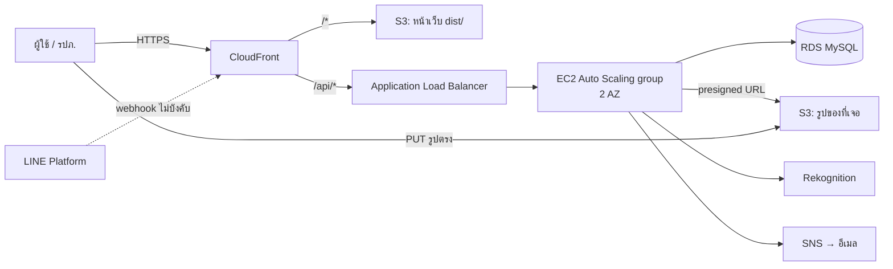

# BU Lost & Found — API Contract (v3)

ข้อตกลงระหว่างหน้าเว็บ (`web/`) กับ backend
Type ฝั่งหน้าเว็บอยู่ที่ [`web/src/api/contract.ts`](../web/src/api/contract.ts) — **ถ้าแก้เอกสารนี้ต้องแก้ไฟล์นั้นด้วย**

> ⚠️ **กฎข้อเดียวที่ห้ามพลาด:** `verificationAnswer` (คำตอบที่ถูกของคำถามยืนยัน) เก็บไว้ในฐานข้อมูลเท่านั้น
> **ห้ามส่งกลับไปในทุก response** ไม่ว่า endpoint ไหน — backend เป็นคนตรวจคำตอบที่ `POST /api/items/{id}/claims` เอง

## 0. สถาปัตยกรรม (ตกลงแล้ว: แบบ B)



| ส่วน | ใช้อะไร | หมายเหตุ |
|---|---|---|
| หน้าเว็บ | S3 + CloudFront | `npm run build:aws` แล้วอัปโหลด `web/dist/` |
| API | ALB → EC2 Auto Scaling (min 1, desired 2, max 3, กระจาย 2 AZ) | target group health check `GET /api/health` |
| ฐานข้อมูล | RDS MySQL 8 (`db.t3.micro`) | อยู่ private subnet, security group เปิด 3306 ให้ SG ของ EC2 เท่านั้น — schema ข้อ 7 |
| รูป | S3 (bucket แยกจากหน้าเว็บ) + presigned URL | ผ่าน CloudFront ได้ถ้าต้องการ |
| AI | Rekognition `DetectLabels`, `DetectText` | ข้อ 3 |
| อีเมล | SNS | ข้อ 2 |

**ทำไม CloudFront ต้องส่ง `/api/*` ไป ALB:** ALB ใน Learner Lab ไม่มี HTTPS (ใช้ ACM ต้องมีโดเมน) หน้าเว็บที่เปิดผ่าน HTTPS เรียก `http://…elb.amazonaws.com` ตรง ๆ ไม่ได้ (mixed content) ให้สร้าง behavior `/api/*` → origin = ALB (origin protocol HTTP), cache policy `CachingDisabled`, origin request policy `AllViewerExceptHostHeader`, allowed methods ทั้งหมด (GET…DELETE) — หน้าเว็บกับ API จะอยู่ origin เดียวกันและไม่ต้องตั้ง CORS ฝั่ง API

**Learner Lab (AWS Academy):**
- Region **`us-east-1`** เท่านั้น (หรือ `us-west-2`)
- สร้าง IAM role เองไม่ได้ → launch template ของ EC2 ใช้ instance profile **`LabInstanceProfile`** แล้ว AWS SDK บนเครื่องจะได้สิทธิ์ S3 / SNS / Rekognition เอง ไม่ต้องใส่ access key ในโค้ด
- ปิด lab แล้ว resource อาจถูกหยุด → ก่อน demo ให้ start lab แล้วเช็กว่า EC2, RDS และ target health เป็นปกติ

**Service ที่นับคะแนนได้ (ไม่นับสีม่วง):** EC2, EC2 Auto Scaling, Elastic Load Balancing, RDS, S3, CloudFront, EBS (ดิสก์ของ EC2), Rekognition, SNS

## 1. สรุป endpoint

| Method | Path | ใช้ที่หน้า | Auth |
|---|---|---|---|
| GET | `/api/health` | ALB health check | – |
| GET | `/api/locations` | ทุกฟอร์ม (dropdown จุดที่เจอ / จุดรับฝาก) | – |
| GET | `/api/stats` | หน้าแรก (3 กล่องตัวเลข), หน้า รปภ. | – |
| GET | `/api/items?q=&category=&location=&status=` | หน้าแรก | – |
| GET | `/api/items/{id}` | หน้ารายละเอียด | – |
| POST | `/api/uploads` | แจ้งเจอของ (ขอ presigned URL รูป) | – |
| POST | `/api/items` | แจ้งเจอของ | – |
| POST | `/api/lost-reports` | แจ้งของหาย | – |
| POST | `/api/items/{id}/claims` | ปุ่ม "นี่ของฉัน" | – |
| GET | `/api/admin/claims?status=verified` | หน้า รปภ. แท็บ "รอส่งคืน" | 🔒 guard |
| POST | `/api/admin/claims/{claimId}/return` | หน้า รปภ. ปุ่ม "ยืนยันคืนแล้ว" | 🔒 guard |
| GET | `/api/admin/items/stale?days=30` | หน้า รปภ. แท็บ "ของค้างนาน" | 🔒 guard |
| POST | `/api/auth/login` | หน้าเข้าสู่ระบบ | – |
| POST | `/api/line/webhook` | LINE Platform เรียก (ไม่ใช่หน้าเว็บ) — ไม่บังคับ ดูข้อ 2 | ลายเซ็น LINE |

## 2. การแจ้งเตือนทางอีเมล: Amazon SNS (ตกลงแล้ว)

**ทำไมไม่ใช้ SES:** SES ใน Learner Lab อยู่โหมด sandbox ส่งได้เฉพาะอีเมลที่ verify ไว้ก่อน ใช้กับผู้ใช้จริงไม่ได้ ส่วน SNS ส่งหาอีเมลใดก็ได้หลังผู้รับกดยืนยันครั้งแรก

**ออกแบบ: 1 topic ต่อ 1 อีเมล** ผู้ใช้กดยืนยันแค่ครั้งแรกครั้งเดียว แจ้งของหายกี่ครั้งก็ใช้ topic เดิม

1. **ตอน `POST /api/lost-reports`**
   ```js
   // topic name ต้องเป็น A-Z a-z 0-9 - _ ≤ 256 ตัว จึงใช้ hash ของอีเมล
   const name = "lostfound-" + sha256(email.toLowerCase()).slice(0, 32);
   const { TopicArn } = await sns.createTopic({ Name: name, Attributes: { DisplayName: "BU Lost & Found" } }); // ชื่อซ้ำ = ได้ topic เดิม
   await sns.subscribe({ TopicArn, Protocol: "email", Endpoint: email });                                   // อีเมลเดิมที่ยืนยันแล้ว = ไม่ส่งซ้ำ
   // เก็บ TopicArn ลง lost_reports.sns_topic_arn
   ```
   `DisplayName` ทำให้ชื่อผู้ส่งเป็น "BU Lost & Found" — หน้าเว็บบอกผู้ใช้ให้มองหาชื่อนี้และกด **Confirm subscription** (มีกล่องเตือนในหน้ายืนยันแล้ว)
2. **ตอนมีของที่ตรงกัน** (หลัง `POST /api/items` หรือจาก Rekognition ข้อ 3)
   ```js
   await sns.publish({
     TopicArn: report.sns_topic_arn,
     Subject: "มีคนแจ้งเจอของที่อาจเป็นของคุณ",   // ≤ 100 ตัวอักษร
     Message: `${item.title}\nฝากไว้ที่: ${dropOff.name} (${dropOff.hours})\nดูรายละเอียด: https://<cloudfront-domain>/#/items/${item.id}`,
   });
   ```
3. **ปิดเรื่อง** (คืนของแล้ว) → `lost_reports.status = 'closed'` แล้วไม่ต้อง publish อีก ไม่ต้องลบ topic

**LINE (ไม่บังคับ):** ส่ง push ได้เฉพาะ `userId` ของคนที่แอด LINE OA แล้ว — ผู้ใช้แอดเพื่อนจากการ์ดในหน้ายืนยัน แล้วพิมพ์รหัสแจ้ง เช่น `lst-8f2a` ในแชท → LINE เรียก `POST /api/line/webhook` → ตรวจ `x-line-signature` → บันทึก `event.source.userId` ลง `lost_reports.line_user_id` → ตอนมีของตรงกันส่ง push เพิ่มจากอีเมล · `contact.lineId`, `contact.phone` ในฟอร์มมีไว้ให้ รปภ. ติดต่อกลับเท่านั้น

## 3. AI: Amazon Rekognition

ทำใน handler ของ `POST /api/items` ทันทีหลังบันทึก (ถ้ามี `imageKey`) — ใช้เวลาราว 1 วินาที:
1. **`DetectLabels`** (`Image.S3Object` = bucket รูป + `imageKey`, `MaxLabels: 5`, `MinConfidence: 80`) → เก็บชื่อ label ภาษาอังกฤษลง `ai_labels` · หน้าเว็บแสดงเป็นชิป "แท็กจาก AI" และ `q` ค้นใน `aiLabels` ด้วย
2. **ถ้าเป็นบัตร** (`category = "card"` หรือ labels มี `ID Cards` / `Document`) → **`DetectText`** → หาเลข 10 หลักด้วย `/\b\d{10}\b/`
3. หา `lost_reports` ที่ `student_id` ตรงกันและ `status = 'open'` → publish SNS (ข้อ 2) "มีคนเจอบัตรของคุณ ฝากไว้ที่ …"
4. **ห้าม**เก็บเลขที่อ่านได้ลงฟิลด์สาธารณะ (`title`, `description`, `ai_labels`) และห้ามส่งออกใน response

ถ้า Rekognition error ให้บันทึกของต่อไปตามปกติด้วย `aiLabels: []` (log error ไว้) — อย่าให้การแจ้งเจอของล้มเพราะ AI

## 4. หลักทั่วไป

| เรื่อง | ข้อตกลง |
|---|---|
| Base path | ทุก endpoint ขึ้นต้นด้วย `/api` (ALB ส่งต่อทั้ง path ไป EC2 — แอปต้อง mount route ที่ `/api`) |
| Format | JSON ทั้ง request/response, `Content-Type: application/json` |
| เวลา | ISO 8601 UTC เช่น `2026-10-27T03:15:00.000Z` (เก็บใน RDS เป็น UTC `DATETIME`) |
| ID | string มี prefix: `itm-` (ของที่เจอ), `lst-` (แจ้งหาย), `clm-` (คำขอรับคืน) |
| Auth | `Authorization: Bearer <token>` — จำเป็นเฉพาะ `/api/admin/*` และต้องเป็น role `guard` |
| CORS | ไม่ต้องตั้งสำหรับ API (origin เดียวกันผ่าน CloudFront) · **bucket รูปต้องตั้ง CORS** ให้ `PUT` จาก `https://<cloudfront-domain>` |
| Error | HTTP status ตามตาราง + body `{ "error": { "code": "NOT_FOUND", "message": "ข้อความที่แสดงให้ผู้ใช้ได้" } }` — หน้าเว็บแสดง `message` ตรง ๆ |

| Status | code | ใช้เมื่อ |
|---|---|---|
| 400 | `VALIDATION` | ข้อมูลไม่ครบ / ผิดรูปแบบ |
| 401 | `UNAUTHORIZED` | ไม่มี token / token หมดอายุ / login ผิด |
| 403 | `FORBIDDEN` | ไม่ใช่ `guard` แต่เรียก `/api/admin/*` |
| 404 | `NOT_FOUND` | ไม่พบ id |
| 409 | `CONFLICT` | ของถูกเคลมไปแล้ว / คืนไปแล้ว |
| 429 | `TOO_MANY_ATTEMPTS` | ตอบคำถามยืนยันผิดเกินกำหนด (ดู claims) |

## 5. Data shapes

```ts
type CategoryId = "electronics" | "wallet" | "card" | "keys" | "bag" | "bottle" | "clothing" | "other";
type FoundItemStatus = "available" | "claimed" | "returned";

interface FoundItem {            // ไม่มี verificationAnswer — ดูกฎด้านบน
  id: string;
  title: string;
  description: string;
  category: CategoryId;
  foundLocationId: string;       // อ้างอิง id จาก GET /api/locations
  dropOffPointId: string;
  foundAt: string;
  reportedAt: string;
  imageUrl: string | null;       // URL รูปที่เปิดได้จากเบราว์เซอร์ (CloudFront หรือ presigned GET)
  status: FoundItemStatus;
  verificationQuestion: string;
  aiLabels: string[];            // Rekognition DetectLabels, อังกฤษ, ไม่เกิน 5 · [] ถ้าไม่มีรูป
}

interface Claim {
  id: string;
  itemId: string;
  itemTitle: string;
  itemCategory: CategoryId;
  claimantName: string;
  studentId: string;
  contact: string;
  dropOffPointId: string;
  pickupCode: string;            // 6 ตัว จาก A-Z และ 2-9 (ไม่มี I, O, 0, 1)
  status: "verified" | "returned";
  createdAt: string;
  returnedAt: string | null;
}
```

## 6. รายละเอียด endpoint

### `GET /api/health`
```json
{ "ok": true }
```
ตอบ 200 เมื่อแอปพร้อมและต่อ RDS ได้ (`SELECT 1`) — ALB ใช้ตัดเครื่องที่เสียออกจาก Auto Scaling group

### `GET /api/locations`
จาก `SELECT * FROM locations`
```json
{
  "foundLocations": [{ "id": "loc-library", "name": "ห้องสมุด", "zone": "โซนกลาง" }],
  "dropOffPoints":  [{ "id": "drop-gate1", "name": "ป้อม รปภ. ประตู 1", "hours": "เปิด 24 ชั่วโมง", "phone": "02-000-0001" }]
}
```

### `GET /api/stats`
```json
{ "waiting": 10, "awaitingPickup": 1, "returnedThisMonth": 4 }
```
`waiting` = ของสถานะ `available` · `awaitingPickup` = claim สถานะ `verified` · `returnedThisMonth` = ของที่ `returned_at` อยู่ในเดือนปัจจุบัน

### `GET /api/items?q=&category=&location=&status=`
ทุก param ไม่บังคับ
- `q` ค้นใน title, description, ชื่อสถานที่ และ `ai_labels` (ไม่สนตัวพิมพ์เล็ก/ใหญ่, ทุกคำต้องเจอ — ใช้ `LIKE` ต่อคำได้)
- `category` = `CategoryId` · `location` = id ของจุดที่เจอ · `status` = `available` | `claimed` | `returned`
- เรียงจาก `found_at` ใหม่สุด
```json
{ "items": [FoundItem, ...] }
```

### `GET /api/items/{id}` → `FoundItem` · 404 ถ้าไม่พบ

### `POST /api/uploads` — ขอลิงก์อัปโหลดรูปตรงเข้า S3
```json
// request
{ "contentType": "image/jpeg" }
// response
{
  "uploadUrl": "https://<image-bucket>.s3.us-east-1.amazonaws.com/uploads/2026/10/abc.jpg?X-Amz-Signature=...",
  "imageKey": "uploads/2026/10/abc.jpg",
  "imageUrl": "https://<cloudfront-domain>/uploads/2026/10/abc.jpg"
}
```
1. หน้าเว็บย่อรูปให้ด้านยาวสุดไม่เกิน 1280px (JPEG) ก่อน
2. หน้าเว็บ `PUT` ไฟล์ไปที่ `uploadUrl` พร้อม header `Content-Type` ตรงกับที่ขอ
3. หน้าเว็บส่ง `imageKey` ไปใน `POST /api/items`

presigned URL อายุ 5 นาทีก็พอ · ยอมรับเฉพาะ `contentType` ที่ขึ้นต้นด้วย `image/`

### `POST /api/items` — แจ้งเจอของ → `201 FoundItem`
```json
{
  "title": "iPhone 15 เคสสีม่วงใส",
  "description": "เจอบนโต๊ะแถวหลัง",
  "category": "electronics",
  "foundLocationId": "loc-library",
  "dropOffPointId": "drop-library",
  "foundAt": "2026-10-27T03:00:00.000Z",
  "imageKey": "uploads/2026/10/abc.jpg",
  "verificationQuestion": "รูปพื้นหลังหน้าจอล็อกเป็นรูปอะไร",
  "verificationAnswer": "แมว"
}
```
- `imageKey` เป็น `null` ได้ (ไม่มีรูป)
- backend ตั้ง `status = "available"`, `reportedAt = now`, `aiLabels` ตามข้อ 3
- response คือ `FoundItem` **ที่ไม่มี** `verificationAnswer`
- หลังบันทึก: หา lost report ที่ตรงกัน (กติกาจับคู่ด้านล่าง + บัตรนักศึกษาจากข้อ 3) แล้ว publish SNS ตามข้อ 2

### `POST /api/lost-reports` — แจ้งของหาย → `201`
```json
// request
{
  "title": "บัตรนักศึกษา",
  "description": "อยู่ในซองใสสีฟ้า",
  "category": "card",
  "lastSeenLocationId": "loc-canteen",
  "lostAt": "2026-10-26T05:00:00.000Z",
  "studentId": "1650707093",
  "contact": { "name": "ธนพล", "email": "thanaphon.j@bumail.net", "lineId": "thanaphon.j", "phone": "" }
}
// response
{ "id": "lst-8f2a", "createdAt": "2026-10-27T03:20:00.000Z", "possibleMatches": [FoundItem, ...] }
```
- **`contact.email` บังคับ** · `lineId`, `phone` ไม่บังคับ ส่งมาเป็น `""` ถ้าไม่กรอก
- `studentId` ไม่บังคับ (`""` ได้) — หน้าเว็บให้กรอกเฉพาะหมวด `card` / `wallet` · ถ้ามีต้องเป็นเลข 10 หลัก
- `possibleMatches` = ของสถานะ `available` ที่ตรงที่สุด ไม่เกิน 3 ชิ้น
- **กติกาจับคู่** (เหมือนใน mock): หมวดตรง +2, สถานที่ตรง +1, คำในชื่อซ้ำกัน +1 ต่อคำ → ได้ ≥ 2 คะแนนถือว่าตรง เรียงคะแนนมากไปน้อย
- สร้าง topic + subscribe อีเมลตามข้อ 2 **ก่อนตอบกลับ** · ถ้า SNS error ให้บันทึกรายงานต่อไปได้ (log error ไว้)

### `POST /api/items/{id}/claims` — ปุ่ม "นี่ของฉัน" → `200`
```json
// request
{ "answer": "Honda", "claimantName": "ธนพล ใจดี", "studentId": "1650707093", "contact": "LINE: thanaphon.j" }

// response — ตอบถูก
{ "status": "verified", "claimId": "clm-91c", "pickupCode": "K7Q2MX", "dropOffPointId": "drop-gate2" }

// response — ตอบผิด (ยัง 200 ไม่ใช่ error)
{ "status": "rejected", "attemptsLeft": 2 }
```
วิธีตรวจคำตอบ (ทำใน backend เท่านั้น):
1. normalize ทั้งสองฝั่ง: NFC → lowercase → ลบช่องว่างทั้งหมด
2. ถูกถ้า **เท่ากันพอดี** หรือ **คำตอบมีคำที่ถูกอยู่ข้างใน** และยาวไม่เกิน `2 × ความยาวคำตอบจริง + 4` (กันการพิมพ์ทุกคำที่เดาไว้รวมกันครั้งเดียว)
3. **จำกัด 2 ชั้น** ผิดเกินชั้นใดชั้นหนึ่ง → ตอบ `429`
   - 3 ครั้งต่อคู่ (`itemId`, `studentId`) — ตาราง `claim_attempts`
   - **6 ครั้งต่อของ 1 ชิ้น รวมทุกรหัสนักศึกษา** — `SUM(failed_count) WHERE item_id = ?`
   - `attemptsLeft` = ค่าที่น้อยกว่าระหว่างสองชั้น

ตอบถูก → ใช้ transaction: `UPDATE found_items SET status='claimed' WHERE id=? AND status='available'` (ถ้าแถวที่แก้ = 0 → `409`) แล้ว `INSERT` claim · รหัสรับของแสดงบนหน้าจอ (หน้าเว็บบอกให้แคปหน้าจอเก็บไว้)

### `GET /api/admin/claims?status=verified` 🔒
```json
{ "claims": [Claim, ...] }
```

### `POST /api/admin/claims/{claimId}/return` 🔒 → `200 Claim`
transaction: claim → `returned` + `returned_at = now`, ของ → `returned` + `returned_at`, lost report ที่เกี่ยวข้อง (ถ้ามี) → `closed` · `409` ถ้าคืนไปแล้ว

### `GET /api/admin/items/stale?days=30` 🔒
ของ `available` ที่ `found_at` เก่ากว่า `days` วัน เรียงจากค้างนานสุด
```json
{ "items": [{ "id": "itm-1012", "title": "...", "daysWaiting": 57, "...": "ฟิลด์อื่นเหมือน FoundItem" }] }
```

### `POST /api/auth/login`
```json
// request
{ "email": "guard@bu.ac.th", "password": "..." }
// response
{ "accessToken": "eyJ...", "user": { "email": "guard@bu.ac.th", "displayName": "เจ้าหน้าที่ รปภ. ประตู 1", "role": "guard" } }
```
ตรวจรหัสผ่านกับ `users.password_hash` (bcrypt) แล้วออก JWT อายุ 8 ชั่วโมง (เก็บ secret ใน environment ของ EC2 ไม่ใช่ในโค้ด)

## 7. RDS schema (MySQL 8)

```sql
CREATE TABLE locations (
  id         VARCHAR(32)  PRIMARY KEY,
  kind       ENUM('found', 'dropoff') NOT NULL,
  name       VARCHAR(100) NOT NULL,
  zone       VARCHAR(100) NULL,          -- เฉพาะ kind = 'found'
  hours      VARCHAR(100) NULL,          -- เฉพาะ kind = 'dropoff'
  phone      VARCHAR(30)  NULL
);

CREATE TABLE found_items (
  id                    VARCHAR(32)  PRIMARY KEY,
  title                 VARCHAR(200) NOT NULL,
  description           TEXT         NOT NULL,
  category              VARCHAR(20)  NOT NULL,
  found_location_id     VARCHAR(32)  NOT NULL REFERENCES locations(id),
  drop_off_point_id     VARCHAR(32)  NOT NULL REFERENCES locations(id),
  found_at              DATETIME     NOT NULL,
  reported_at           DATETIME     NOT NULL,
  image_key             VARCHAR(255) NULL,
  status                ENUM('available', 'claimed', 'returned') NOT NULL DEFAULT 'available',
  verification_question VARCHAR(255) NOT NULL,
  verification_answer   VARCHAR(255) NOT NULL,   -- ห้าม SELECT ไปใส่ response
  ai_labels             JSON         NOT NULL,
  returned_at           DATETIME     NULL,
  INDEX idx_items_status_found (status, found_at)
);

CREATE TABLE lost_reports (
  id                    VARCHAR(32)  PRIMARY KEY,
  title                 VARCHAR(200) NOT NULL,
  description           TEXT         NOT NULL,
  category              VARCHAR(20)  NOT NULL,
  last_seen_location_id VARCHAR(32)  NOT NULL REFERENCES locations(id),
  lost_at               DATETIME     NOT NULL,
  student_id            CHAR(10)     NULL,
  contact_name          VARCHAR(100) NOT NULL,
  contact_email         VARCHAR(254) NOT NULL,
  contact_line_id       VARCHAR(50)  NOT NULL DEFAULT '',
  contact_phone         VARCHAR(20)  NOT NULL DEFAULT '',
  sns_topic_arn         VARCHAR(255) NULL,
  line_user_id          VARCHAR(64)  NULL,
  status                ENUM('open', 'closed') NOT NULL DEFAULT 'open',
  created_at            DATETIME     NOT NULL,
  INDEX idx_lost_student (student_id, status),
  INDEX idx_lost_category (category, status)
);

CREATE TABLE claims (
  id             VARCHAR(32)  PRIMARY KEY,
  item_id        VARCHAR(32)  NOT NULL REFERENCES found_items(id),
  claimant_name  VARCHAR(100) NOT NULL,
  student_id     CHAR(10)     NOT NULL,
  contact        VARCHAR(200) NOT NULL,
  pickup_code    CHAR(6)      NOT NULL,
  status         ENUM('verified', 'returned') NOT NULL DEFAULT 'verified',
  created_at     DATETIME     NOT NULL,
  returned_at    DATETIME     NULL,
  INDEX idx_claims_status (status)
);

CREATE TABLE claim_attempts (
  item_id      VARCHAR(32) NOT NULL,
  student_id   CHAR(10)    NOT NULL,
  failed_count INT         NOT NULL DEFAULT 0,
  PRIMARY KEY (item_id, student_id)
);

CREATE TABLE users (
  email         VARCHAR(254) PRIMARY KEY,
  password_hash VARCHAR(100) NOT NULL,
  display_name  VARCHAR(100) NOT NULL,
  role          ENUM('student', 'guard') NOT NULL
);
```
ข้อมูลตั้งต้นของ `locations` คัดลอกจาก `campusDirectoryFixture` ใน [`web/src/fixtures/mockData.ts`](../web/src/fixtures/mockData.ts) ได้เลย (แก้ชื่อให้ตรงกับมหาวิทยาลัยจริง)

## 8. ทดสอบกับหน้าเว็บ

```bash
cd web
# ใส่ VITE_LINE_OA_URL ใน .env.aws ถ้ามี LINE OA
npm run build:aws   # ได้ dist/ ที่เรียก /api จริง ไม่มี mock data / บัญชีทดลอง
aws s3 sync dist/ s3://<web-bucket>/ --delete
aws cloudfront create-invalidation --distribution-id <id> --paths "/*"
```
ระหว่างพัฒนา หน้าเว็บใช้ mock ที่ทำตามเอกสารนี้ (ยกเว้นการส่งอีเมล/LINE และ Rekognition ที่จำลองด้วย label ตามหมวด) ดูพฤติกรรมอ้างอิงได้ที่ `web/src/api/mock/mockClient.ts`
